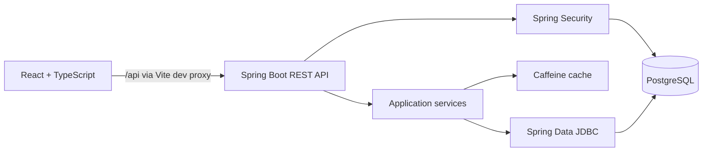

# QuickBite

A food-ordering web application built with **React, TypeScript, Spring Boot, and PostgreSQL**. The project combines a restaurant discovery interface with a Java backend for authentication, menus, and shopping carts.

## Highlights

- **Restaurant discovery:** browse restaurants and menus, search dishes, filter cuisines, and save favorite restaurants locally.
- **Authentication:** registration and login flows backed by Spring Security and PostgreSQL.
- **Frontend engineering:** React Router, TanStack Query, loading skeletons, empty states, and API error handling.
- **Backend engineering:** controller/service/repository layers, Spring Data JDBC, and Caffeine caching for restaurant and menu data.
- **Cart APIs:** retrieve a customer's cart, add menu items, update quantities and totals, and clear the cart.

## Current scope

Restaurant browsing and authentication use the backend API. The current React cart, checkout, and confirmation pages demonstrate the UI with sample cart data; connecting those pages to the existing cart APIs is a next step. The backend checkout endpoint clears the cart. Payment processing and persistent order history are not implemented.

## Technology stack

| Layer | Technologies |
| --- | --- |
| Frontend | React, TypeScript, Vite, React Router, Tailwind CSS, TanStack Query |
| Backend | Java 21, Spring Boot, Spring Security, Spring Data JDBC, Caffeine |
| Database | PostgreSQL 18 |
| Development & testing | Docker Compose, Gradle Wrapper, JUnit 5, Mockito, Oxlint |

## Architecture



The Vite development server forwards `/api/*` to `http://localhost:8080/*`. Browser requests include session cookies. Backend JSON uses snake_case field names.

```text
QuickBite/
├── backend/
│   ├── src/main/java/com/laioffer/onlineorder/
│   │   ├── controller/     # REST endpoints
│   │   ├── service/        # Application logic
│   │   ├── repository/     # Database access
│   │   ├── entity/         # Persistent records
│   │   └── model/          # Request and response models
│   ├── src/main/resources/ # Configuration and database initialization
│   └── src/test/           # Cart unit tests and context test
└── frontend/quickbite/
    └── src/
        ├── pages/         # Discovery, restaurant, auth, and cart views
        ├── components/    # Reusable UI and feedback states
        └── lib/           # API client, queries, session, and types
```

## Run locally

### Requirements

- Java 21
- Node.js 22.12+ and npm; see [Vite's Node.js requirements](https://vite.dev/guide/)
- Docker with Docker Compose

### 1. Clone the repository

```bash
git clone https://github.com/ppyuanGorgeous/QuickBite.git
cd QuickBite
```

### 2. Start PostgreSQL and the backend

```bash
cd backend
docker compose up -d db
INIT_DB=always bash ./gradlew bootRun
```

The backend listens on `http://localhost:8080`. Database initialization creates the schema and seeds restaurant/menu data.

**Use a disposable local database for the first start.** `INIT_DB=always` runs a script that drops and recreates the application tables. For subsequent starts that should preserve data, use:

```bash
INIT_DB=never bash ./gradlew bootRun
```

The bundled Compose file and backend defaults are aligned for local development. For a different database, configure `DATABASE_URL` (hostname only), `DATABASE_PORT`, `DATABASE_USERNAME`, and `DATABASE_PASSWORD`. The database name is `onlineorder`.

### 3. Start the frontend

In another terminal, from the repository root:

```bash
cd frontend/quickbite
npm ci
npm run dev
```

Open the URL printed by Vite, normally `http://localhost:5173`. Register a test account to explore authentication and restaurant menus.

Optional frontend configuration can be placed in `frontend/quickbite/.env.local`:

```dotenv
API_PROXY_TARGET=http://localhost:8080
VITE_API_BASE_URL=/api
VITE_LOGOUT_PATH=/logout
```

## API overview

These are backend paths; the development frontend accesses them through the `/api` proxy prefix.

| Method | Endpoint | Purpose |
| --- | --- | --- |
| GET | `/restaurants/menu` | List restaurants and menus |
| GET | `/restaurant/{restaurantId}/menu` | Get one restaurant's menu |
| POST | `/signup` | Register a customer |
| POST | `/login` | Log in with form-encoded credentials |
| POST | `/logout` | End the session |
| GET | `/cart` | Retrieve the authenticated customer's cart |
| POST | `/cart` | Add a menu item using `{"menu_id": 1}` |
| POST | `/cart/checkout` | Clear the authenticated customer's cart |

## Tests and build commands

The repository includes four `CartServiceTests` unit tests covering new items, repeated items, cart retrieval, and clearing a cart.

```bash
# From backend/: run cart unit tests without starting the application
bash ./gradlew test --tests 'com.laioffer.onlineorder.CartServiceTests'
```

The full backend test suite also includes a Spring context test and requires a configured PostgreSQL database. Use a disposable test database because the default initialization mode recreates the tables.

```bash
# From backend/, with a disposable database available
INIT_DB=always bash ./gradlew test

# From frontend/quickbite/
npm run lint
npm run build
```

## Next steps

- Connect the cart and checkout UI to the cart query and mutation hooks.
- Add persistent order records and an order history view.
- Add end-to-end workflow tests and a hosted demonstration.
